```{r setup}
#| include: false
SciViews::R
tab_question <- read$rds("data/tab_question.rds")
# Builds fig_words, fig_hist, fig_hist2 and fig_agree
source("data/pres_g8_feedback_figures.R", local = TRUE)
```

## Qui sommes-nous ?

:::: {.columns}
::: {.column width="50%"}
::: profil
### Philippe Grosjean

{.portrait}

- Professeur
- Biologiste marin
- Développeur en R
:::
:::
::: {.column width="50%"}
::: profil
### Guyliann Engels

{.portrait}

- Adjoint pédagogique
- Biologiste marin
- Utilisateur de R
:::
:::
::::

## Les cours de science des données dans le cursus en biologie

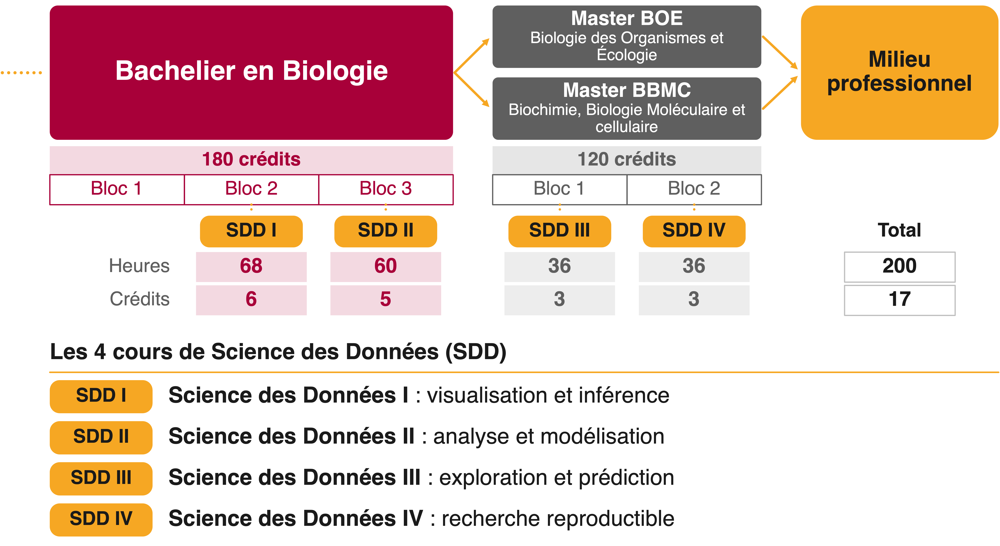{.centre width="74%"}

## Science des données biologiques à l'Université de Mons

### On veut des étudiants **actifs**

**Cours classique *ex cathedra* + séances d'exercices**

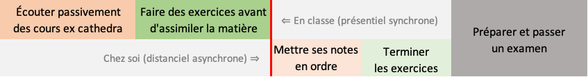{width="85%"}

**Approche en classe inversée**

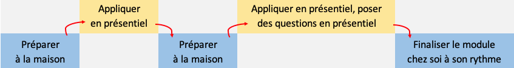{width="85%"}

## Enseigner la science des données biologiques

Ce cursus vise à donner une série de compétences englobant des notions de biologie, de statistique et de programmation afin de **répondre à une question biologique.**

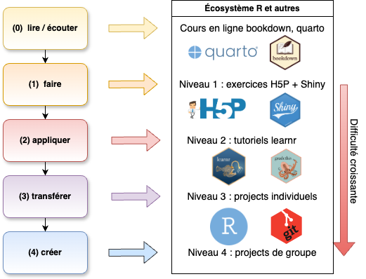{.centre height="470px"}

## Évaluer les apprentissages en science des données

Le grand défi est de proposer une **évaluation** en accord avec les **objectifs d'apprentissage** et les **activités d'enseignement**.

:::: {.columns}
::: {.column width="50%"}
**Statistique & biologie** : évaluation via des projets, des QCM, des questions ouvertes…

::: pieges
**Programmation**

- Projets : les étudiants peuvent s'entraider ou utiliser l'IA
- Examen papier : écrire du code R sur papier est artificiel et frustrant
:::
:::
::: {.column width="50%"}
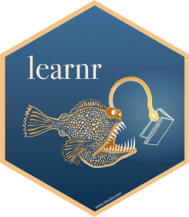{width="90px"}

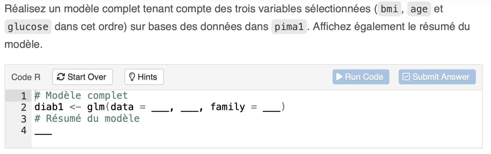{.shot width="100%"}
:::
::::

## learnr comme bon candidat

### Une interrogation sur **ordinateur**, via un **outil connu**, avec des questions variées

```{r}
data.frame(
  Type = c("QCM", "Question ouverte", "Codage en R"),
  Exemple = c(
    "Interpréter un tableau résumé de modèle",
    "Définir la déviance des résidus",
    "Ajuster un GLM, comparer deux modèles"
  ),
  `Ce qu'on évalue` = c(
    "Compréhension conceptuelle",
    "Capacité d'explication",
    "Compétence pratique réelle"
  ),
  check.names = FALSE
) |>
  knitr::kable()
```

::: retenir
Un learnr par défaut ne permet pas d'**enregistrer les résultats**, ni de s'exécuter dans un **environnement contrôlé**.
:::

## Adaptation du learnr pour l'évaluation

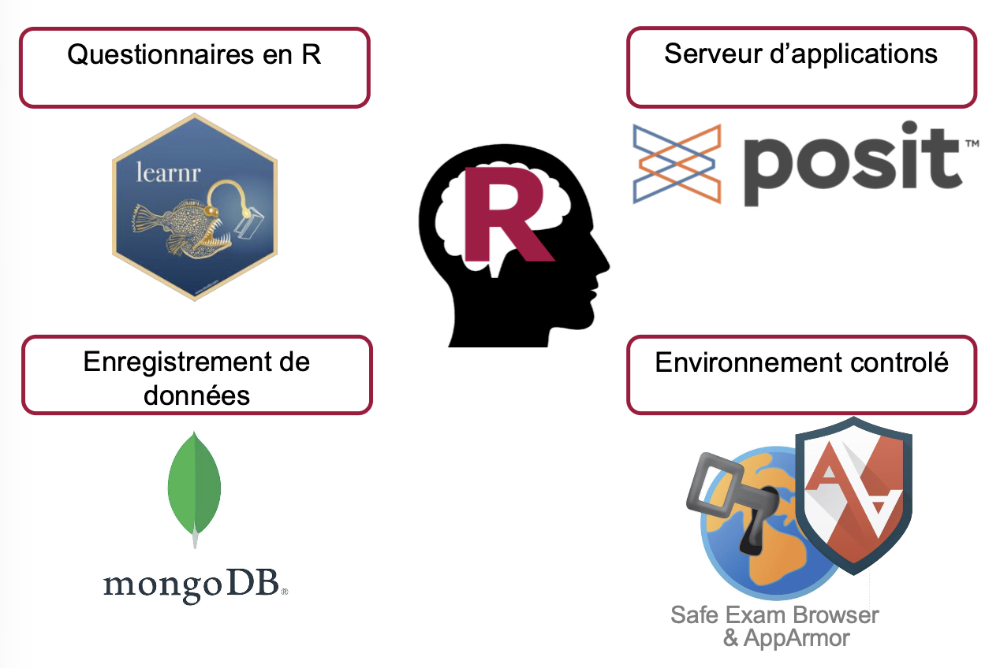{.r-stretch .centre}

## Passation du test par l'étudiant

:::: {.columns}
::: {.column width="82%"}
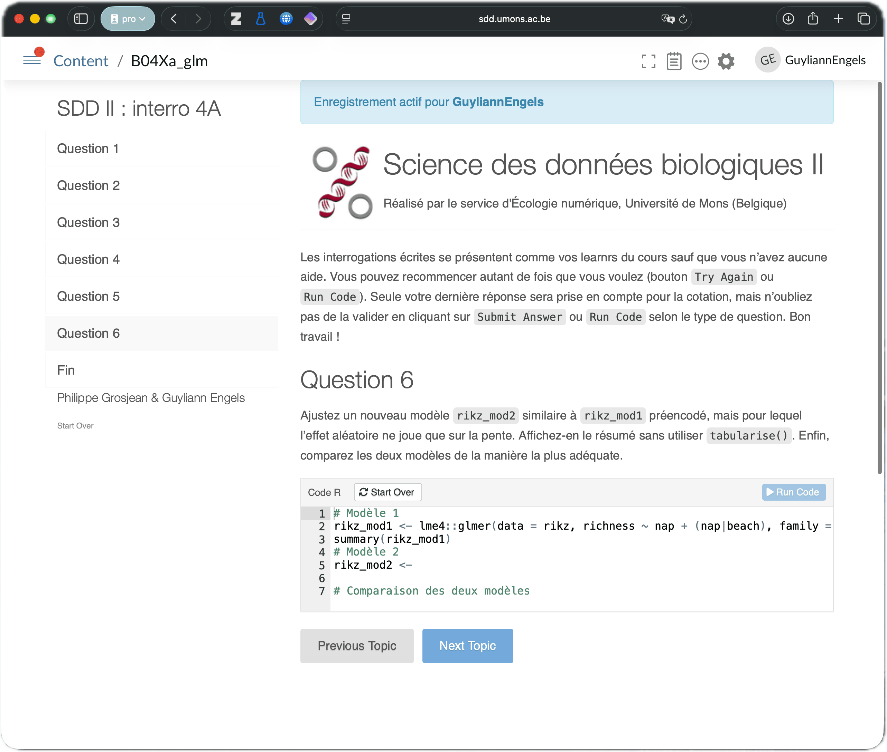{.centre .shot height="560px"}
:::
::: {.column width="18%"}
{width="100%"}
:::
::::

## Sécurisation à deux niveaux

:::: {.columns}
::: {.column width="50%"}
### Côté client — [Safe Exam Browser](https://safeexambrowser.org/news_en.html)

{height="110px"}

- Fichier *.seb* distribué aux étudiants avant l'épreuve
- Mode kiosque : accès restreint aux pages autorisées (learnr + site de cours)
:::
::: {.column width="50%"}
### Côté serveur — AppArmor

{height="110px"}

- Profil restreint pour le processus R
- Accès limité aux packages R nécessaires
:::
::::

::: retenir
Deux couches indépendantes : sécurité robuste sans sacrifier l'interactivité.
:::

## Correction de l'enseignant : {learnitgrid}

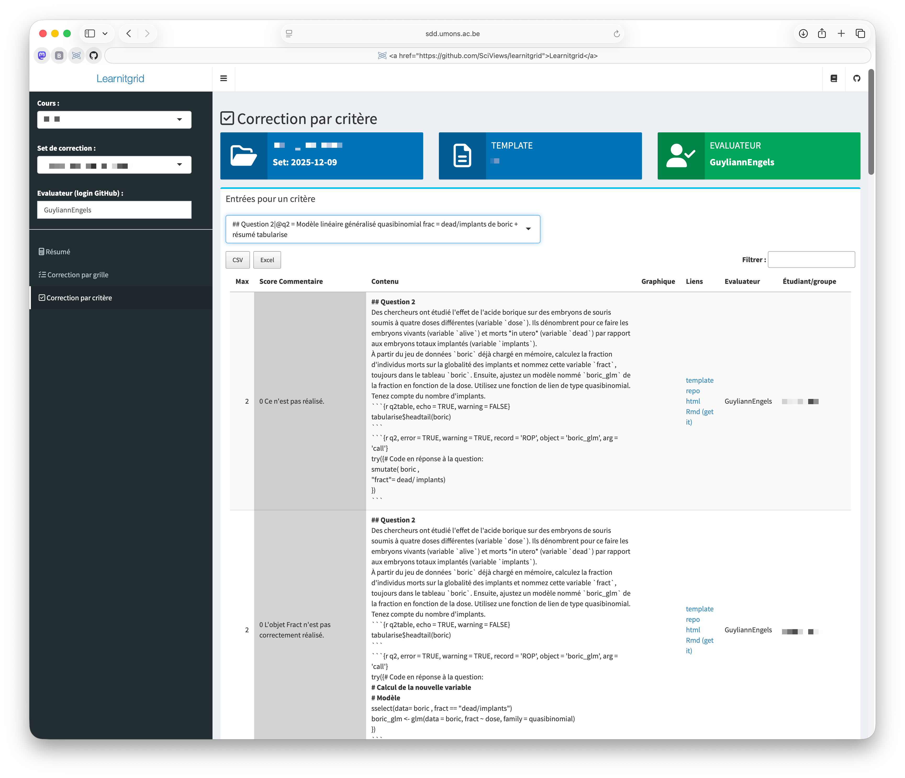{.r-stretch .centre .shot}

## Correction assistée : longueur du feedback

### → Le LLM rédige un feedback plus long, même pour les réponses correctes

```{r}
#| fig-width: 10.5
#| fig-height: 5
#| out-height: "510px"
fig_hist2 + labs(title = NULL)
```

## Correction assistée : accord avec la note de l'enseignant

### → Désaccord important : l'enseignant reste garant de la note

```{r}
#| fig-width: 9.5
#| fig-height: 4.2
#| out-width: "90%"
fig_agree + labs(title = NULL)
```

## Correctif issu du même Rmd que le learnr

Un [seul fichier R Markdown](https://github.com/BioDataScience-Course/sdd_presentations/blob/master/2026_rencontresr_nantes/learnr_exam/exam_example.Rmd) avec des balises spéciales pour le questionnaire interactif ({learnr}) et pour le corrigé (fichier HTML).

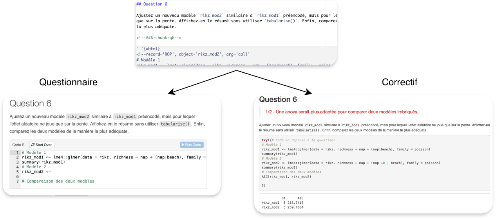{.r-stretch .centre}

## Rapport de correction de l'étudiant

### Exemple anonymisé d'un correctif en HTML

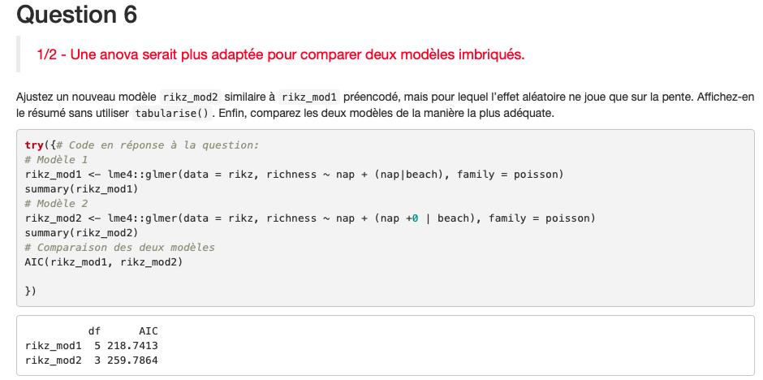{.centre .shot width="80%"}

## Ce que les données révèlent : maîtrise du langage

### → Amélioration dans l'écriture du code

```{r}
#| fig-width: 9
#| fig-height: 3.6
#| out-height: "500px"
tab_question |>
  filter_(~ type == "code") |>
  mutate_(syntax_valid = ~ n_evaluated / n_executed) |>
  drop_na_(~syntax_valid) |>
  summarise_(
    mean_valid = ~ fmean(syntax_valid),
    .by = c("course", "user")
  ) |>
  chart(mean_valid ~ course) +
  geom_boxplot(aes(fill = course), alpha = 0.3, width = 0.5,
    outlier.shape = NA, show.legend = FALSE) +
  geom_jitter(aes(color = course), width = 0.15, alpha = 0.6, size = 2,
    show.legend = FALSE) +
  scale_fill_manual(values = c(A = "#E74C3C", B = "#3498DB", C = "#2ECC71")) +
  scale_color_manual(values = c(A = "#E74C3C", B = "#3498DB", C = "#2ECC71")) +
  scale_y_continuous(labels = scales::percent_format()) +
  labs(y = "Code syntaxiquement valide (%)", x = "Cours")
```


## Ce que les données révèlent : tentatives & résultats

### → Augmentation de la complexité des questions

```{r}
#| fig-width: 10
#| fig-height: 3.8
#| out-height: "500px"
tab_question |>
  filter_(~ type == "code") |>
  drop_na_(~z_score, ~z_ntry) |>
  summarise_(
    mean_ntry = ~ fmean(ntry),
    mean_ntry_valid = ~ fmean(n_evaluated),
    mean_score = ~ fmean(prop_score) * 20,
    n_questions = ~ fn(label),
    .by = c("course", "user")
  ) -> tab_temp

tab_temp |>
  chart(mean_score ~ mean_ntry_valid %col=% course | course) +
  geom_point(alpha = 0.8, size = 2, show.legend = FALSE) +
  geom_hline(yintercept = 10, linetype = "dashed", color = "red",
    linewidth = 0.5) +
  scale_color_manual(values = c(A = "#E74C3C", B = "#3498DB", C = "#2ECC71")) +
  geom_vline(xintercept = fmean(tab_temp$mean_ntry_valid, na.rm = TRUE),
    linetype = "dashed", color = "red", linewidth = 0.5) +
  labs(
    x = "Nombre moyen de tentatives de code syntaxiquement valide",
    y = "Note moyenne sur 20"
  )
```


## Conclusions

:::: {.columns}
::: {.column width="55%"}
::: {.etapes .petit}
1. **Source unique** : épreuve + corrigé depuis un seul fichier
2. Données du learnr enregistrées dans une **base de données** (MongoDB)
3. **Double sécurisation** (Safe Exam Browser + AppArmor)
4. **Grilles de correction** pour chaque question (learnitgrid)
5. **Bonus** : données exploitables pour mesurer la progression des étudiants
:::

[**À suivre** : *Enseignement des statistiques avec R et learnitr : approche explicite en mode hybride et évaluation continue* (Philippe Grosjean)]{.a-suivre}
:::
::: {.column width="45%"}
::: liens
**Liens utiles**

- Matériel exemple : <https://go.sciviews.org/learnr_exam>
- learnitr : <https://learnitr.r-universe.dev>
    + **learnitdown** : enregistrement learnr dans la base de données
    + **learnitgrid** : interface de correction
    + **learnitprogress** : rapport de correction pour l'étudiant (HTML)
    + **learnitexam** : futur package si intérêt de la communauté
- Contact : <sdd@sciviews.org>
:::
:::
::::
