```{r setup, include=FALSE}
knitr::opts_chunk$set(echo = FALSE, warning = FALSE, message = FALSE)
```

### Enseigner les statistiques et R à des étudiants réfractaires

\vfill

Cursus universitaire en biologie, 4 cours Bab2, Bab3, Ma1 & Ma2 (option), 17
crédits, 200h en présentiel, 30 modules, voir [\alert{\underline{https://wp.sciviews.org}}](https://wp.sciviews.org)

\vfill

{width='65%'}

### Inspiration : enseignement explicite

\begincols
\begincol{.50\textwidth}

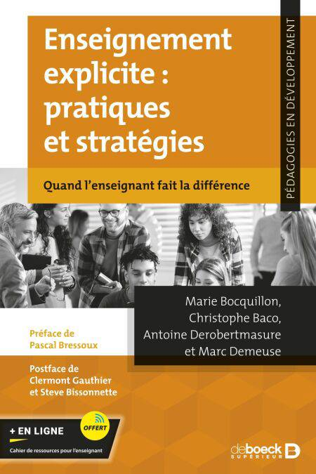{width='80%'}

\endcol
\begincol{.50\textwidth}

Utilisation d'un \alert{LRS, Learning Record Store} : base de données récoltant 
les traces d'apprentissage. Évaluation objective de l'impact des pratiques
pédagogiques sur l'apprentissage et l'inclusivité

\endcol
\endcols

### Progressivité : 4 niveaux de difficulté croissante

(cf présentation précédente de Guyliann Engels)

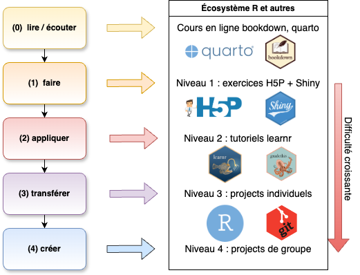{width='80%'}

### Besoin d'outils logiciels (originaux pour certains) : LearnIt::R

{width='100%'}


## Motiver et capter l'attention pour les exercices hors présentiel

### Exercices facultatifs - peu de participation

Cours de math, exercices interactifs en ligne proposés sans précautions particulières

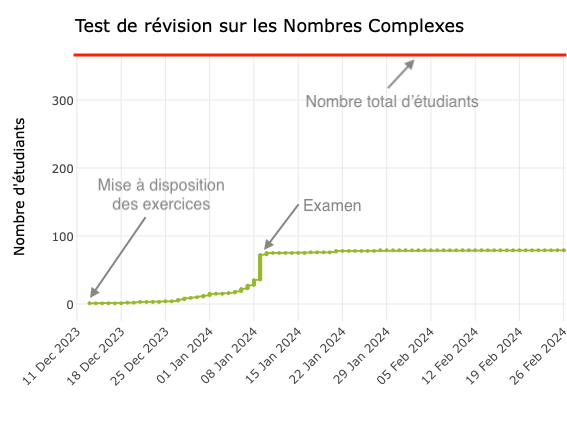{width='80%'}

### Participation - des solutions...

**Varier** le type d'exercices : **\alert{H5P}**

- Plus de 50 types d'exercices différents, voir [https://h5p.org](https://h5p.org/)

\vfill

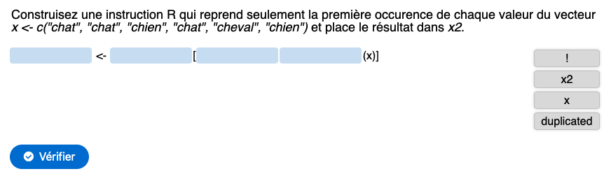{width='100%'}

\vfill

\vfill

\vfill

### Participation - des solutions...

**Varier** le type d'exercices : **H5P** + **\alert{learnr}**

- Tutoriels avec écriture de code R, voir [https://rstudio.github.io/learnr/](https://rstudio.github.io/learnr/)

\vfill

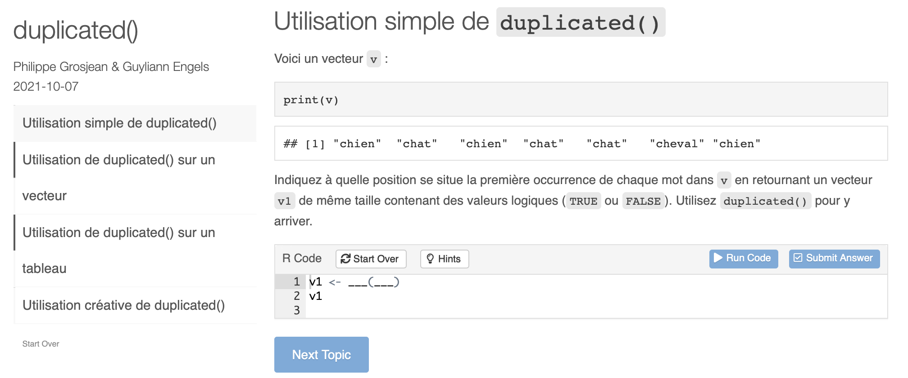{width='100%'}

\vfill

### Participation - des solutions...

**Varier** le type d'exercices : **H5P** + **learnr** + **\alert{Shiny}**

- Démonstration de concepts statistiques avec [https://shiny.rstudio.com/](https://shiny.rstudio.com/)

{width='80%'}

### Participation - des solutions...

-   Exercices directement **dans le cours en ligne**

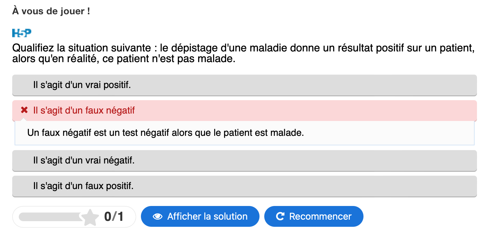

\vfill

### Participation - des solutions...

-   Exercices directement dans le cours en ligne

-   **Liste des exercices** à la fin de chaque module

{width='80%'}


### Participation - des solutions...

-   Exercices directement dans le cours en ligne

-   Liste des exercices à la fin de chaque module

-   **Points attribués à la réalisation des exercices** (exemple, 5% de la note finale)

{width='60%'}


### Participation - des solutions...

-   Exercices directement dans le cours en ligne

-   Liste des exercices à la fin de chaque module

-   Points attribués à la réalisation des exercices (exemple, 5% de la note finale)

-   **Rapport de progression** en temps réel

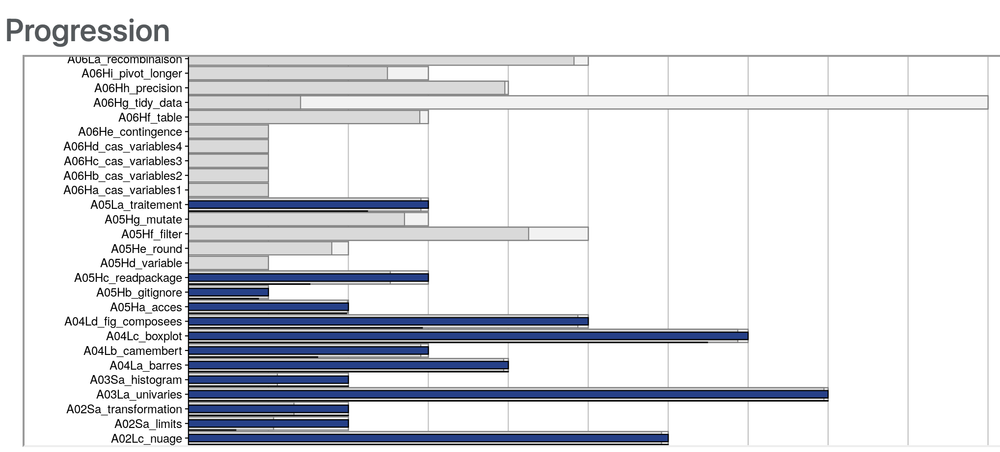{width='85%'}

### Participation - résultat

**Plus de 90%** de participation observée aux exercices en ligne de nos cours

{width='80%'}


## Progressivité dans l'application pratique de la statistique

### Exercices de difficulté croissante

Niveaux 0 à 2 déjà discutés (H5P - Shiny - learnr)

{width='100%'}

### Niveau 3 : projets GitHub cadrés (R, RStudio, Quarto)

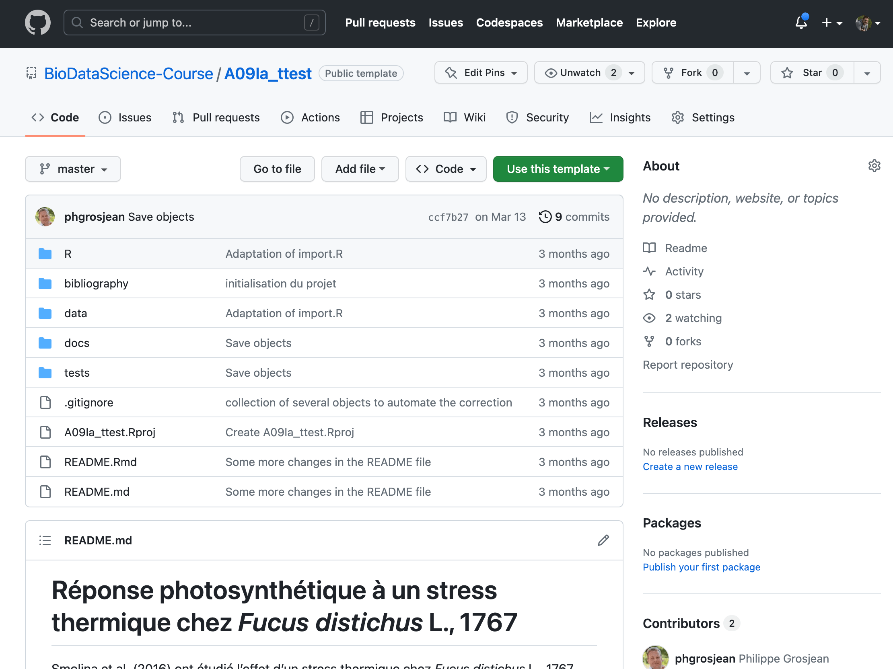{width='70%'}

### Niveau 3 : projets GitHub cadrés (R, RStudio, Quarto)

- **Instructions** sous forme de commentaires

\vfill

{width='80%'}

\vfill

### Niveau 3 : projets GitHub cadrés (R, RStudio, Quarto)

- Instructions sous forme de commentaires

- Interprétation par **sélection des phrases correctes**

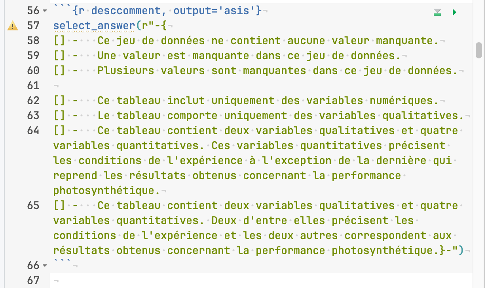{width='80%'}

### Niveau 3 : projets GitHub cadrés (R, RStudio, Quarto)

- Instructions sous forme de commentaires

- Interprétation par sélection des phrases correctes

- **Évaluation semi-automatique** avec {testthat} + suggestions pour s'améliorer

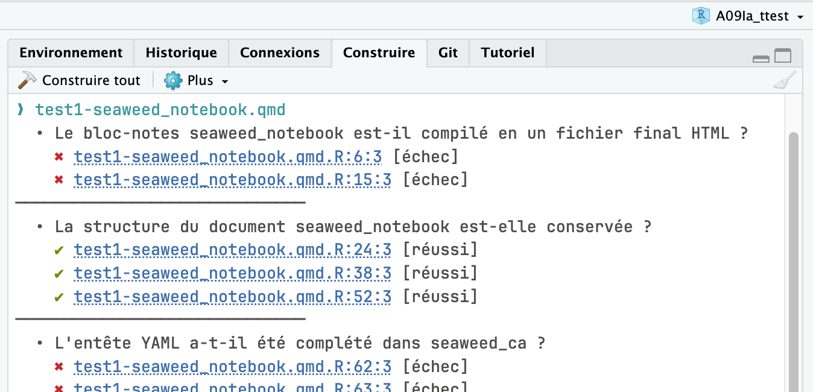{width='80%'}

### Niveau 3 : correction des projets (grilles critériées)

100 étudiants * 10 projets * 30 critères = 30.000 notes (+ commentaires, voir présentation précédente de Guyliann Engels) !

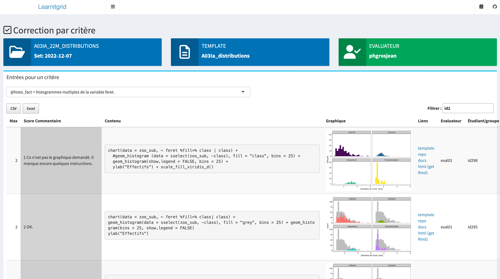{width='100%'}

### Niveau 4 : projets GitHub libres par groupes de 4

- Choix d'un jeu de données ouvertes (Zenodo, Dryad...)

- Même environnement logiciel que pour le niveau 3 (R, RStudio, Quarto)

- Consignes minimales : explorer dans un bloc-notes, mettre au net dans un rapport

- Coaching individualisé en classe

- Utilisation de l'IA encouragée et devant être explicitée dans le rapport

___

\begin{center}
\textbf{Avez-vous des questions ?}
\end{center}

\vfill

**Plateforme pédagogique LearnIt::R** : [\underline{\alert{https://github.com/learnitr}}](https://github.com/learnitr)

*en cours d'élaboration sur base du code développé pour nos cours*

\vfill

- Site web du cours : [\alert{https://wp.sciviews.org/}](https://wp.sciviews.org/)

- Cette présentation : 
[\alert{https://go.sciviews.org/cfies2026}](https://go.sciviews.org/cfies2026)

- Bocquillon, M., Baco, Ch., Derobertmasure, A. et Demeuse, M. (2024), Enseignement explicite : pratiques et stratégies. Quand l’enseignant fait la différence. De Boek Supérieur ed., Louvain-La-Neuve 304pp.

- Engels, G., Grosjean, Ph., et Artus, F. (2023). Teaching data science to students in biology
using R, RStudio and learnr: Analysis of three years data. Foundations of Data Science,
5(2), 266–285. https://doi.org/10.3934/fods.2022022
