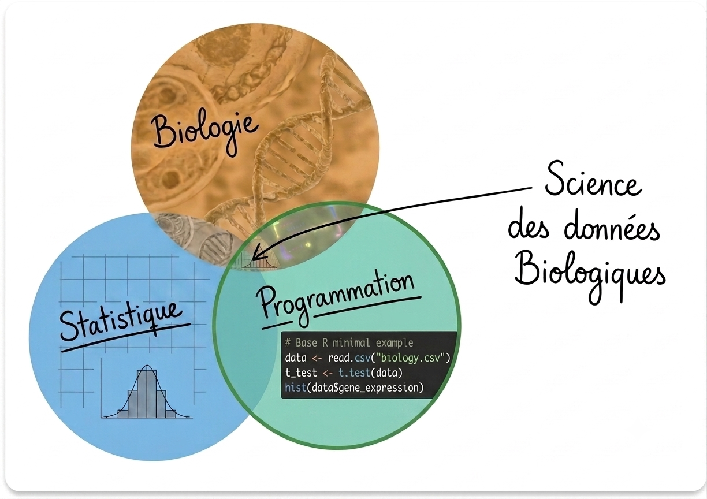
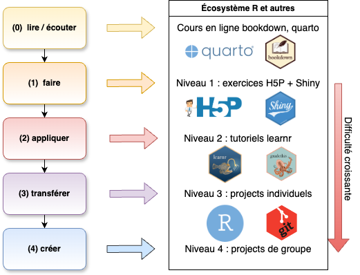
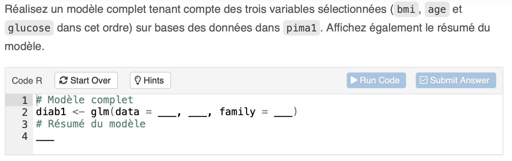
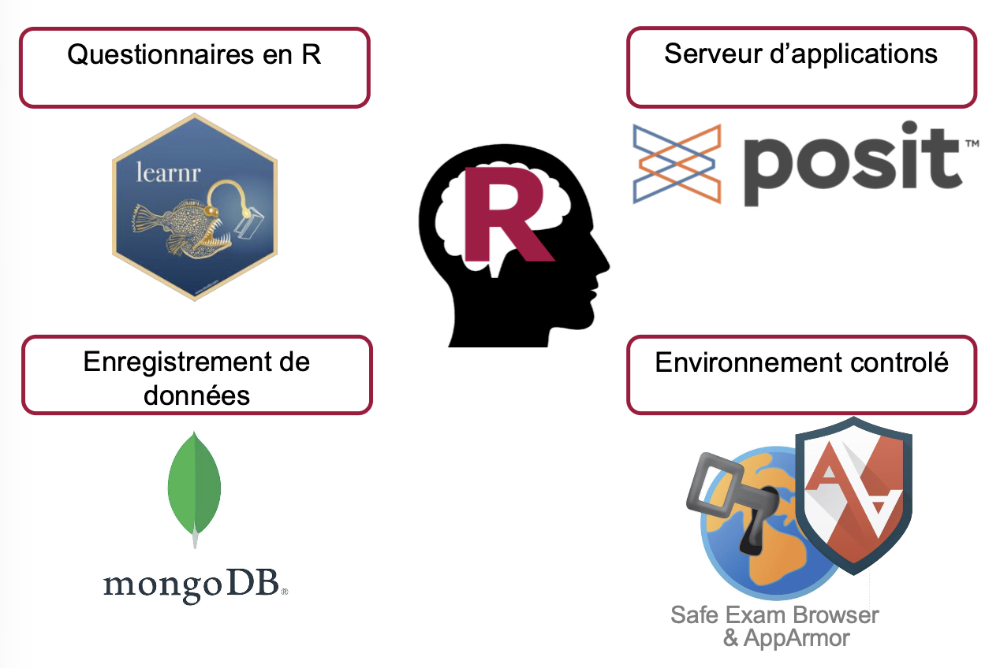
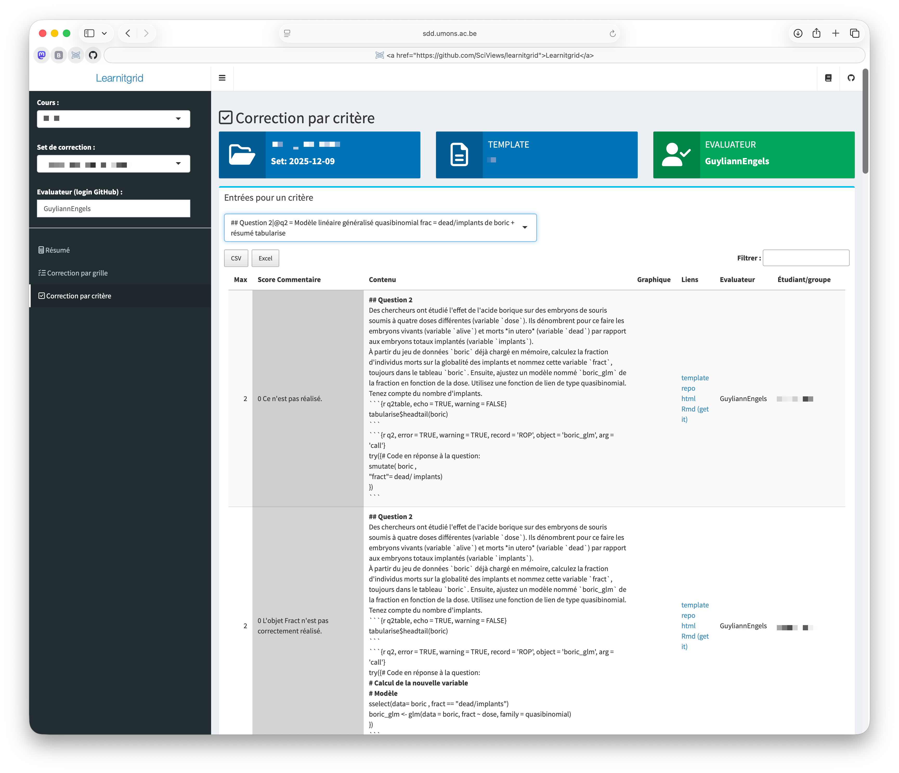
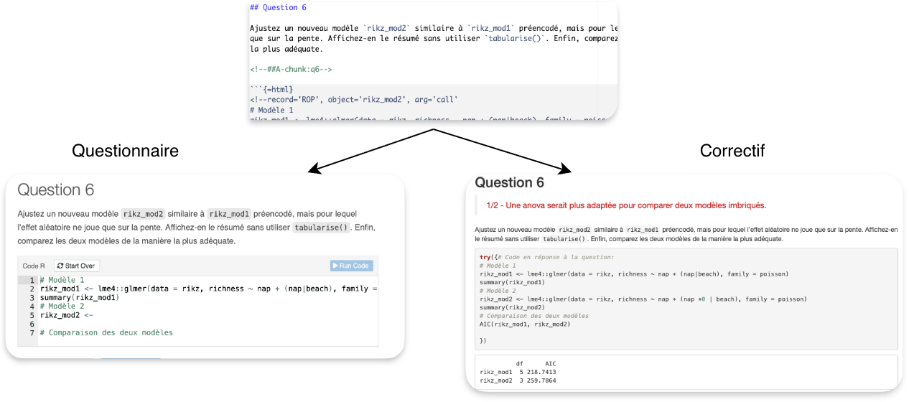
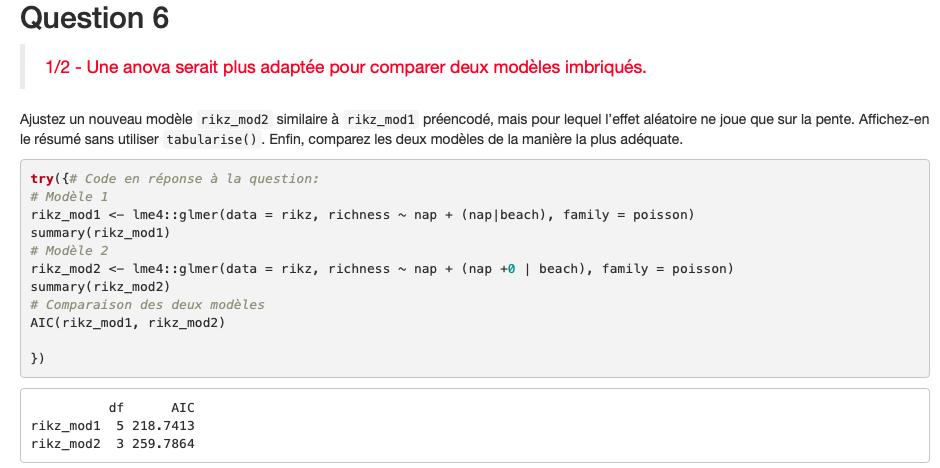

```{r setup, include=FALSE}
knitr::opts_chunk$set(echo = FALSE, warning = FALSE, message = FALSE, fig.height=3)
SciViews::R
tab_question <- read$rds("data/tab_question.rds")
```

### Définir la science des données biologiques 

\vfill



### Enseigner la science des données biologiques 

Ce cursus vise à donner une série de compétence englobant des notions de biologie, de statistique et de programmation afin de **répondre à une question biologique.**

{width='65%'}

[\alert{\underline{https://wp.sciviews.org}}](https://wp.sciviews.org)

### Evaluer les apprentissages en science des données  

La grand défi est de proposer une **évaluation** en accord avec les **objectifs d'apprentissage** et des **activités d'enseignement**

**Statistique & biologie** : Evaluation via des projets, des QCM, des questions ouvertes,...

**Programmation** : 

- Evaluation via des projets => les étudiants peuvent s'entraider ou utiliser l'IA
- Examen papier =>Écrire du code R sur papier est artificiel et frustrant


{width='10%'} Employer un outil comme {learnr} ?

{width='80%'} 

### learnr comme bon candidat

learnr permet de réaliser une interrogation sur **ordinateur**, via un **outil connu** avec des questions variées

```{r, echo=FALSE}

df <- data.frame(
  Type = c("QCM", "", "Question ouverte", "", "Codage en R"),
  Exemple = c(
    "Interpréter un tableau résumé de modèle",
    "",
    "Définir la déviance des résidus",
    "",
    "Ajuster un GLM, comparer deux modèles"
  ),
  `Ce qu'on évalue` = c(
    "Compréhension conceptuelle",
    "",
    "Capacité d'explication",
    "",
    "Compétence pratique réelle"
  ),
  check.names = FALSE
) 

knitr::kable(df, booktabs = TRUE) 

#  kableExtra::row_spec(3, bold = TRUE)
#tabularise(df) |> flextable::autofit()
```

Un learnr par défaut ne permet pas d'**enregistrer les résultats**, ni de s'exécuter dans un **environnement controlé**.

### Adaptation du learnr pour l'évaluation



### Passation du test par l'étudiant

\putat{-20}{-160}{\includegraphics[width=110mm]{screenshots/learnr_posit2.png}}
\putat{280}{80}{\includegraphics[width=20mm]{figures/posit.png}}

### Sécurisation à deux niveaux

**Côté client — [Safe Exam Browser](https://safeexambrowser.org/news_en.html)**

\putat{245}{-15}{\includegraphics[width=20mm]{figures/safeexam.jpg}}

- Fichier *.seb* distribué aux étudiants avant l'épreuve
- Mode kiosque : accès restreint aux pages autorisées (learnr + site de cours)


\vfill


**Côté serveur — AppArmor**

\putat{245}{-35}{\includegraphics[width=20mm]{figures/apparmor.png}}

- Profil restreint pour le processus R
- Accès limité aux packages R nécessaires

\vfill

Deux couches indépendantes => sécurité robuste sans sacrifier l'interactivité

### Correction de l'enseignant : {learnitgrid}

{width='125%'}

### Correctif issu du même Rmd que le learnr

Un [seul fichier R Markdown](https://github.com/BioDataScience-Course/sdd_presentations/blob/master/2026_rencontresr_nantes/learnr_exam/exam_example.Rmd) avec des balises spéciales pour le questionnaire interactif ({learnr}) et pour le corrigé (fichier HTML).



### Rapport de correction de l'étudiant

Exemple anonymisé d'un correctif en HTML 




### Ce que les données révèlent : maîtrise du langage

```{r, echo=FALSE}
tab_question |>
    filter_(~ type == "code") |>
    mutate_(syntax_valid = ~ n_evaluated / n_executed) |>
    drop_na_(~syntax_valid) |>
    summarise_(
        mean_valid = ~ fmean(syntax_valid),
        .by = c("course", "user")
    ) |>
    chart(mean_valid ~ course) +
    geom_boxplot(
        aes(fill = course),
        alpha = 0.3,
        width = 0.5,
        outlier.shape = NA,
        show.legend = FALSE
    ) +
    geom_jitter(
        aes(color = course),
        width = 0.15,
        alpha = 0.6,
        size = 2,
        show.legend = FALSE
    ) +
    scale_fill_manual(values = c(A = "#E74C3C", B = "#3498DB", C = "#2ECC71")) +
    scale_color_manual(
        values = c(A = "#E74C3C", B = "#3498DB", C = "#2ECC71")
    ) +
    scale_y_continuous(labels = scales::percent_format()) +
    labs(
        #title = "Proportion de code syntaxiquement valide moyen par étudiant et par cours",
        y = "Code syntaxiquement valide (%)",
        x = "Cours"
    ) +
        theme(text = element_text(size = 9))
```

=> Amélioration dans l'écriture du code

### Ce que les données révèlent : tentatives & résultats

```{r, echo=FALSE}
tab_question |>
    filter_(~ type == "code") |>
    drop_na_(~z_score, ~z_ntry) |>
    summarise_(
        mean_ntry = ~ fmean(ntry),
        mean_ntry_valid = ~ fmean(n_evaluated),
        mean_score = ~ fmean(prop_score) * 20,
        n_questions = ~ fn(label),
        .by = c("course", "user")
    ) -> tab_temp

tab_temp |>
    #chart(med_z_score ~ med_z_ntry %col=% med_score | course) +
    chart(mean_score ~ mean_ntry_valid %col=% course | course) +
    geom_point(alpha = 0.8, size = 2, show.legend = FALSE) +
    geom_hline(
        yintercept = 10,
        linetype = "dashed",
        color = "red",
        linewidth = 0.5
    ) +
    #scale_fill_manual(values = c(A = "#E74C3C", B = "#3498DB", C = "#2ECC71")) +
    scale_color_manual(
        values = c(A = "#E74C3C", B = "#3498DB", C = "#2ECC71")
    ) +
    geom_vline(
        xintercept = fmean(tab_temp$mean_ntry_valid, na.rm = TRUE),
        linetype = "dashed",
        color = "red",
        linewidth = 0.5
    ) +
    labs(
        #title = "Résultat moyen aux questions de code vs nombre moyen de tentatives de code syntaxiquement valide",
        x = "Nombre moyen de tentatives de code syntaxiquement valide",
        y = "Note moyenne sur 20"
    ) +
        theme(text = element_text(size = 9))
```

=> Augmentation de la complexité des questions 

### Conclusions

- Source unique : épreuve + corrigé depuis un seul fichier
- Récupération des données du learnr dans une base de données (MongoDB)
- Double sécurisation (Safe Exam Browser + AppArmor)
- Génération de grilles de correction pour chaque question (via learnitgrid)
- Bonus : Données exploitables pour mesurer la progression des étudiants


\vfill

**Liens utiles :**

- Matériel exemple : <https://go.sciviews.org/learnr_exam>
- learnitr : <https://learnitr.r-universe.dev>
    + learnitdown : Enregistrement learnr dans la base de données
    + learnitgrid : Interface de correction
    + learnitprogress : Rapport de correction pour l'étudiant (HTML)
    + learnitexam : Futur package si intérêt de la communauté
- Contact : <sdd@sciviews.org>

