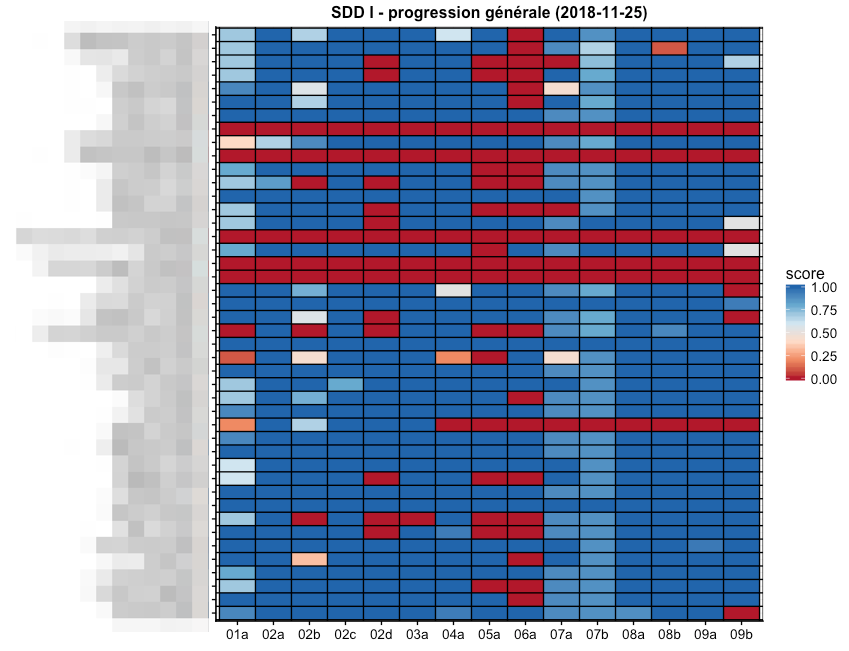

# Présentations relatives au projet SDD à l'UMONS

Ce dépôt centralise l’ensemble des présentations, des posters et des outils de démonstration employés pour présenter la méthode d’enseignement de nos cours de Science des Données Biologiques à l'Université de Mons.

Depuis la rentrée académique 2017-2018, un processus de réflexion est lancé afin de renouveler l’enseignement de la biostatistique au sein du cursus de biologie. Avec la masse de données en croissance exponentielle, nécessitant des outils spécialisés pour les aborder, la crise de la reproductibilité́ en science, l’Open Science, l’Open Data, l’Open Knowledge (Directives européennes), les besoins des étudiants ont évolués.

Les noms des cours sont changés en Sciences des Données Biologiques. Le changement du nom de ces cours va de pair avec une remise en question profonde des notions indispensables à enseigner aux biologistes en matière de science des données ainsi que sur la méthode d’enseignement. Les notions importantes ont été précisément définie et répartie entre les cours de science des données I à V (dont les cours I, II et III sont des cours obligatoires).

Le premier cours de sciences des données biologiques I a été élaboré et dispensé lors de l'année académique 2018-2019. Des données sur l'utilisation du matériel pédagogique par les étudiants sont collectées depuis ce moment afin de permettre une analyse de l'apprentissage par les étudiants dans le but de l'améliorer encore. Prenons comme exemple, la participation aux exercices de type "learnrs". Un très haut taux de participation des étudiants est observé à ces séances d'exercices. Ceci indique donc une forte implication dans l'apprentissage de la matière par la quasi-totalité de la classe.

Le nom des étudiants en ordonnée est flouté. Les différentes séances d'exercices sont en abscisse. Les scores indiquent le taux de réponses aux questions de ces learnrs.

## Présentations

Les présentations sont classées de la plus récente à la plus ancienne.

- `2026_cfies_unamur`, présentations : **Transformer l'évaluation des étudiants en science des données biologiques grâce à des tutoriels interactifs** (G. Engels & Ph. Grosjean) et **Enseignement des statistiques avec R et LearnItR : approche explicite en mode hybride et évaluation continue** (Ph. Grosjean & G. Engels). ORBi : https://orbi.umons.ac.be/handle/20.500.12907/57447 (G. Engels & Ph. Grosjean).

Le colloque CFIES 2026, organisé à l'Université de Namur, a été l'occasion de présenter deux communications. La première décrit notre dispositif d'évaluation continue sur ordinateur à l'aide de questionnaires interactifs (learnr) permettant aux étudiants d'exécuter du code R dans un environnement sécurisé, avec une correction assistée par une interface web dédiée et la collecte des traces d'apprentissage dans un Learning Record Store. La seconde présente notre approche d'enseignement des statistiques avec R et l'écosystème LearnItR. Le texte de la communication est dans `2026_cfies_unamur/` et les présentations dans `presentation_ge/` et `presentation_phg/`. Du matériel supplémentaire est disponible ici : https://go.sciviews.org/learnr_exam.

- `2026_ULB_UMONS`, présentation : **Statistiques et apprentissage : deux publics, deux approches (ULB *vs* UMONS)**

En juillet 2026, une rencontre entre l'ULB (HeLSci ; M. Giladi et B. Caucheteux) et l'UMONS (Service d'Écologie numérique ; Ph. Grosjean et G. Engels) a permis de comparer nos approches pédagogiques en statistiques : e-learning et classe inversée, engagement des apprenants (progression par niveaux, gamification), suivi des activités (learning analytics) et encadrement de l'IA côté apprenants comme côté formateurs.

- `2026_rencontresr_nantes`, présentation : **Utilisation de tutoriels learnr pour évaluer des étudiants en science des données biologiques**. Poster : **svTidy et le "formula-masking" : une alternative intéressante à {dplyr} et {tidyr} pour remanier vos jeux de données**. ORBi : https://orbi.umons.ac.be/handle/20.500.12907/56341 (présentation), https://orbi.umons.ac.be/handle/20.500.12907/56342 (poster).

Lors des Rencontres R 2026 à Nantes, nous avons présenté notre dispositif d'évaluation continue basé sur R et {learnr}, où les étudiants testent leur code R durant l'épreuve dans un processus R strictement cadré (Safe Exam Browser et AppArmor), la correction se faisant ensuite avec {learnitgrid}. Un exemple d'examen et sa version corrigée sont dans `2026_rencontresr_nantes/learnr_exam/` (voir son `README.md`). Le poster présente le package [{svTidy}](https://github.com/SciViews/svTidy), une alternative à {dplyr} et {tidyr} qui remplace la "tidy evaluation" par le "formula-masking".

- `2026_jde`, poster : **Exécuter du code lors d'une évaluation sécurisée en ligne** ORBi : https://orbi.umons.ac.be/handle/20.500.12907/56160.

La journée des enseignants de l'UMONS 2026 a été l'occasion de présenter, sous le slogan « Bien plus que des QCM en ligne », notre dispositif d'évaluation sur ordinateur permettant de rédiger des réponses en R et de les tester de manière interactive, Safe Exam Browser limitant l'accès aux ressources informatiques pendant l'interrogation.

- `2026_BePa_Winter_School`, cours : **Initiation to Statistics in Proteomics Analysis**

Lors de la BePa Winter School 2026 à l'UMONS, Ph. Grosjean a donné une initiation aux statistiques pour l'analyse de données de protéomique. Le dossier contient la présentation, les scripts R des exemples et les figures générées.

- `2025_rencontresr_mons`, présentation : **Pages d'aide simplifiées et en français dans R grâce à l'IA** ORBi : https://orbi.umons.ac.be/handle/20.500.12907/55085.

Les Rencontres R 2025 ont eu lieu à l'Université de Mons. Nous y avons présenté le package [{helpai}](https://github.com/SciViews/helpai) qui génère, grâce à l'IA choisie par l'utilisateur, des pages d'aide simplifiées, éventuellement en français, pour les fonctions R. Ces pages s'affichent comme les pages d'aide habituelles (onglet "Help" de RStudio) et renvoient vers la documentation officielle.

- `2025_jde`, poster : **Pages d'aide simplifiées et en français dans R grâce à l'IA** ORBi : https://orbi.umons.ac.be/handle/20.500.12907/52237.

Lors de la journée des enseignants de l'UMONS 2025, nous avons présenté le package {helpai} dans le contexte de nos cours. Le LLM utilisé est spécialisé pour répondre aux notions des cours et un serveur dédié à l'UMONS assure la confidentialité des données dans le respect du RGPD. Les traces d'activité sont collectées pour analyser l'impact de cet outil sur les apprentissages.

- `2024_sap`, présentation : **Apprentissage de la science des données, six ans d'innovation pédagogique, et ensuite ?**

En juillet 2024, nous avons fait le bilan de six années d'innovation pédagogique dans les cours de science des données biologiques avec le Service d'Appui Pédagogique (SAP) de l'UMONS.

- `2024_rencontresr_vannes`, présentation en séance plénière : **Apprendre R et les statistiques... grâce à R**. La vidéo de la présentation sera accessible sous peu. Poster : **Des tableaux et des graphiques prêts à publication avec les packages R {tabularise} et {chart} de la suite SciViews**. ORBi (poster) : https://orbi.umons.ac.be/handle/20.500.12907/49210.

Les 12 au 14 juin 2024 ont vu se dérouler les Rencontres R 2024 à Vannes. À cette occasion, nous avons eu l'honneur d'être invité à présenter nos travaux en pédagogie avec R dans une session plénière. Le public était très réceptif. Nous avons aussi présenté un poster sur les packages {tabularise} et {chart} de la suite SciViews qui visent à faciliter la réalisation de tableaux et de graphiques, entre autres, en lien avec les modèles statistiques utilisés. Gros succès aussi puisqu'il a obtenu le prix du meilleur poster (avec deux autres ex æquos).

- `2023_rencontresr_avignon`, présentation : **Application {shiny} de correction de projets individuels utilisant R, RStudio et GitHub**. La vidéo de la présentation est accessible ici: https://www.youtube.com/watch?v=FacqP_Ek8Eg. ORBi : https://orbi.umons.ac.be/handle/20.500.12907/46108.

Les rencontres R 2023 ont eu lieu à Avignon du 21 au 23 juin 2023. Nous en avons profité pour présenter notre application de correction de projets par grilles critériées, basée sur {learnitgrid} et {shiny}. Cette application permet de corriger les projets des étudiants de manière plus rapide et plus objective, tout en leur fournissant des retours plus détaillés sur leur travail.

Nous avons aussi fait le point sur la traduction en français de R, voir: https://www.youtube.com/watch?v=ikJ3wsB7gSI.

- `2023_jde`, évènement : **Correction par grilles critériées** ORBi : https://orbi.umons.ac.be/handle/20.500.12907/45963.

La journée des enseignants de l'UMONS du 17 mai 2023, dans sa cinquième édition, a été l'occasion de présenter une nouvelle méthode de correction des projets des étudiants en sciences des données biologiques. Cette méthode est basée sur des grilles critériées, qui permettent une correction plus rapide et plus objective des projets des étudiants. Un application Shiny, implémentée dans le package [{learnitgrid}](https://github.com/learnitr/learnitgrid) accélère le remplissage ce ces grilles critériées.

- `2021_rencontresr_paris`, présentations : **Retour d'expérience sur l'enseignement de la science des données biologiques en classe inversée**. La vidéo démo associée est disponible ici: https://filedn.com/lzGVgfOGxb6mHFQcRn9ueUb/sdd_presentations/rr2021_engels_demo.mp4. **Perception de R et RStudio par des apprenants dans des cours de science des données biologiques**. L'exercice H5P est à https://h5p.org/node/1193264. Le learnr de démonstration est dans `/2021_rencontresr_paris/learnr/duplicated.Rmd`. Le plus simple est de l'ouvrir dans RStudio et puis de cliquer sur le bouton "Run Document" pour l'exécuter (les packages {learnr}, {gradethis} -`remotes::install_github("rstudio/gradethis")`-, {dplyr} et {tibble} sont nécessaires). ORBi : https://orbi.umons.ac.be/handle/20.500.12907/35553 (retour d'expérience), https://orbi.umons.ac.be/handle/20.500.12907/1087 (perception de R et RStudio).

Les Rencontres R 2021 à Paris les 12 et 13 juillet 2021, partiellement en présentiel,  nous ont permis de présenter plus en détails nos cours de Science des Données Biologiques sous forme de deux exposées successifs de 25 min chacun dans une ambiance plus familière. Le premier exposé détaille le matériel pédagogique (h5p, learnr, projects GitHub, bookdown intégré dans un site Wordpress avec identification via son compte GitHub et Moodle), ainsi que quelques données sur les exercices. La seconde présentation se focalise sur l'apprentissage et l'approche en 4 niveaux d'exercices de difficulté croissante élaborés pour ces cours pour assurer l'assimilation des concepts par la très grosse majorité (>90%) de nos étudiants. Leur perception générale, ainsi que la charge cognitive et l'utilisabilité des outils est également discutée.

- `2021_user_zurich`, note technique : **Teaching Biology students to code smoothly with learnr and gradethis**. La lightning talk sur **An Integrated Teaching Environment for R with {learnitdown}** est disponible ici: https://filedn.com/lzGVgfOGxb6mHFQcRn9ueUb/sdd_presentations/UseR_Grosjean_Engels.mp4. ORBi : https://orbi.umons.ac.be/handle/20.500.12907/34660 (note technique), https://orbi.umons.ac.be/handle/20.500.12907/19984 (lightning talk).

Le colloque User!2021, organisé par l'Université de Zürich en distanciel les 5 à 9 juillet 2021 fût l'occasion de brièvement présenter les avancées dans nos cours de Science des Données Biologiques. La note technique se focalise sur l'utilisation de {learnr} et {gradethis}, tandis que l'"elevator pitch" de 5 minutes introduit la plateforme pédadogique que nous avons mis au point pour ces cours. Elle est centrée autour du package R {learnitdown}.

- `2019_user_toulouse`, poster : **Better learning of data science in a biology curriculum by using R, RStudio, learnr & GitHub Classroom** ORBi : https://orbi.umons.ac.be/handle/20.500.12907/31497.

Le colloque UseR!2019 qui regroupe les utilisateur mondiaux de R s'est déroulé les 9-12 juillet 2019 à Toulouse. Nous y avons présenté un poster présentant notre méthode d'enseignement de la Science des Données Biologiques à l'UMONS.

- `2019_JDE`, évènement : **Rendons les étudiants acteurs de leur propre apprentissage de la Science des Données Biologiques** ORBi : https://orbi.umons.ac.be/handle/20.500.12907/12653 (Classe inversée et outils interactifs), https://orbi.umons.ac.be/handle/20.500.12907/742 (Analyse des résultats de quiz interactifs).

Lors de la journée des enseignants de l'UMONS du 15 mars 2019, nous avons organisé un stand (combinaison d'un poster, d'une présentation et d'outils) afin de présenter notre philosophie d'apprentissage de la Science des Données Biologiques. Nous avons intitulé ce stand "Rendons les étudiants acteurs de leur propre apprentissage de la Science des Données Biologiques".

- `2018_vice_recteur`, présentation : **Science des Données Biologiques : Rendons les étudiants actifs de leurs apprentissages**

Lors d'une réunion avec le vice-recteur à l'enseignement de l'Université de Mons (Prof. Marc Demeuse), nous avons réalisé une présentation intitulée : "Science des données biologiques : Rendons les étudiants actifs de leurs apprentissages".

- `2018_rennes`, poster : **Introduction de nouveaux outils (learnr, Github classroom, ...) dans les cours de Science des Données Biologiques à l'UMONS** ORBi : https://orbi.umons.ac.be/handle/20.500.12907/9782.

Lors de la septième édition des rencontres R à Rennes sur le site de l'Agrocampus Ouest du 4 au 6 juillet 2018, nous avons présenté le poster s'intitulant : "Introduction de nouveaux outils (learnr, Github classroom, . . . ) dans les cours de Science des Données en Biologie".
